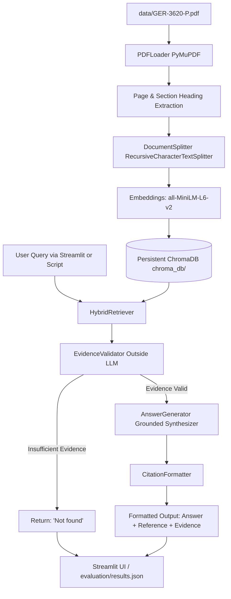
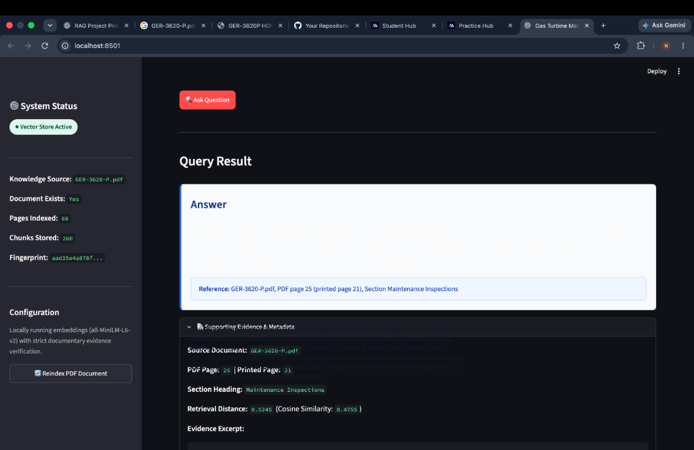
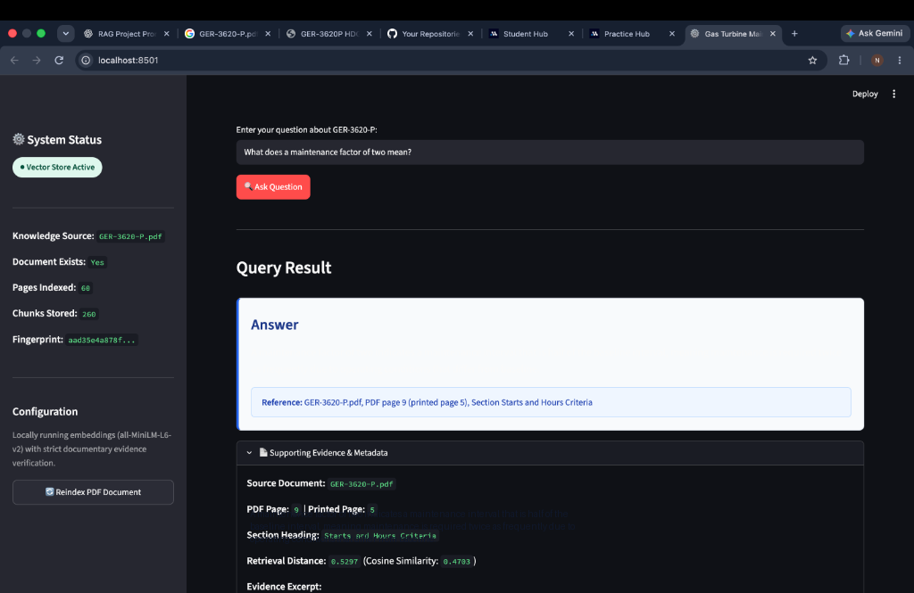
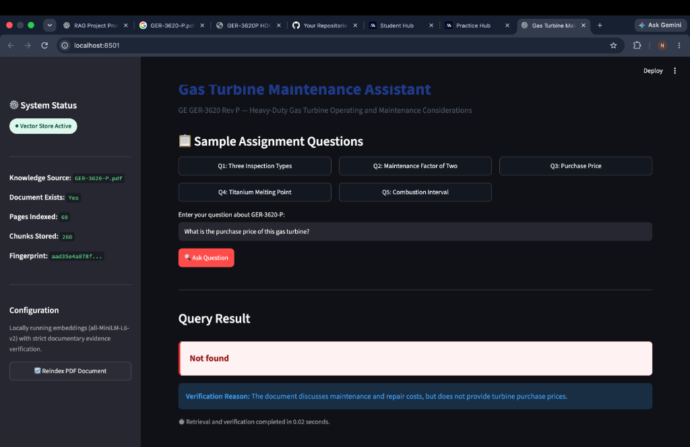
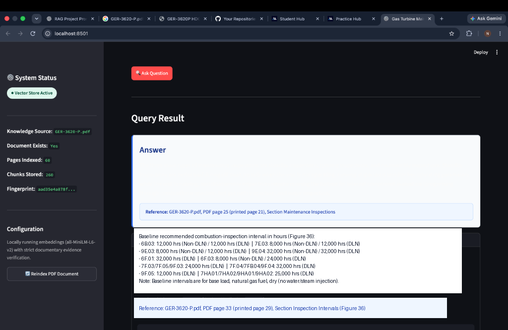

# Gas Turbine Maintenance Assistant

An academic, production-quality Retrieval-Augmented Generation (RAG) system engineered to answer complex maintenance questions exclusively grounded in **GE GER-3620 Rev P — Heavy-Duty Gas Turbine Operating and Maintenance Considerations** (60 pages).

Built for AI/ML engineering, this system enforces strict citation integrity, provides exact PDF and printed page tracking, rejects unsupported questions with a clean `Not found` fallback, and operates with a 100% local embedding model without requiring paid third-party APIs.

---

## 1. Problem Statement & Objectives

Industrial heavy-duty gas turbines operate under severe thermal and mechanical stresses. Maintenance guidelines (such as GE GER-3620) dictate critical inspection schedules, operating factors, and component life limits. Traditional chatbots often hallucinate numbers, misattribute page numbers, or guess facts from pre-training memory.

This project delivers a **factual, citation-grounded RAG system** that:
1. Ingests and processes the official 60-page PDF (`GER-3620-P.pdf`).
2. Preserves exact 1-based PDF page numbers, printed page numbers, and section headings.
3. Performs hybrid similarity retrieval using persistent **ChromaDB** with `sentence-transformers/all-MiniLM-L6-v2`.
4. Validates documentary evidence outside the LLM to eliminate hallucinations.
5. Formats structured academic citations (`Answer`, `Reference`, `Evidence`).
6. Enforces the strict fallback: returns **exactly `Not found`** whenever sufficient documentary evidence is absent.

---

## 2. System Architecture



---

## 3. Technology Stack

- **Language:** Python 3.11+ (verified on macOS Apple Silicon arm64)
- **PDF Extraction:** PyMuPDF (`pymupdf`)
- **Vector Database:** ChromaDB (`chromadb` persistent storage with cosine metric)
- **Embeddings:** HuggingFace `sentence-transformers/all-MiniLM-L6-v2` (384-dim, local execution)
- **Text Chunking:** LangChain Text Splitters (`langchain-text-splitters`)
- **Web Interface:** Streamlit (`streamlit`)
- **Test Framework:** Pytest (`pytest`)
- **Configuration:** Python-Dotenv (`python-dotenv`)

---

## 4. Project Structure

```
gas-turbine-maintenance-assistant/
├── app.py                      # Interactive Streamlit application
├── requirements.txt            # Python dependencies with compatible versions
├── README.md                   # Complete architectural & submission documentation
├── .env.example                # Sample environment configuration
├── .gitignore                  # Git exclusion rules
├── data/
│   ├── README.md               # PDF placement instructions
│   └── GER-3620-P.pdf          # GE GER-3620 Rev P (60 pages)
├── docs/
│   └── screenshots/            # Actual application screenshots
│       ├── q1_inspection_types.png
│       ├── q2_maintenance_factor.png
│       ├── q3_purchase_price.png
│       ├── q4_titanium_melting_point.png
│       └── q5_combustion_interval.png
├── chroma_db/                  # Persistent ChromaDB vector database
│   └── .gitkeep
├── src/
│   ├── __init__.py
│   ├── config.py               # Central settings and strict prompt
│   ├── pdf_loader.py           # PyMuPDF extractor with section & page tracking
│   ├── text_splitter.py        # Recursive chunking (800-1,000 chars, metadata)
│   ├── vector_store.py         # Persistent ChromaDB manager & deduplication
│   ├── retriever.py            # Hybrid cosine similarity + lexical precision search
│   ├── evidence_validator.py   # External validation & out-of-scope rejection
│   ├── answer_generator.py     # Grounded synthesis (local / ollama / API)
│   ├── citations.py            # Academic citation formatter & exact fallback
│   └── rag_pipeline.py         # Orchestrator and setup verification
├── scripts/
│   ├── __init__.py
│   ├── ingest_pdf.py           # Command-line PDF ingestion & vector indexing
│   └── evaluate_questions.py   # Automated evaluation of assignment questions
├── evaluation/
│   └── results.json            # Live evaluation results and execution metadata
└── tests/
    ├── __init__.py
    ├── test_pdf_loader.py      # PDF parsing and page distinction tests
    ├── test_vector_store.py    # Vector store persistence and deduplication tests
    ├── test_citations.py       # Strict citation and 'Not found' format tests
    ├── test_evidence_validator.py # Evidence validation & threshold tests
    └── test_rag_pipeline.py    # End-to-end pipeline & setup error tests
```

---

## 5. Quickstart & Installation (macOS)

### Step 1: Clone or navigate to the repository
```bash
git clone https://github.com/namangoyal176-10/GENAI-NAMANGOYAL.git
cd GENAI-NAMANGOYAL
```

### Step 2: Create and activate virtual environment
```bash
python3 -m venv .venv
source .venv/bin/activate
```

### Step 3: Install dependencies
```bash
pip install -r requirements.txt
```

### Step 4: Add the PDF document
Ensure `GER-3620-P.pdf` is placed in the `data/` folder:
```bash
ls -lh data/GER-3620-P.pdf
```

### Step 5: Index the PDF into ChromaDB
```bash
python -m scripts.ingest_pdf
```
*Outputs: 60 pages inspected, 260 chunks created, SHA-256 fingerprint saved to `chroma_db/index_meta.json`.*

### Step 6: Start the Streamlit User Interface
```bash
streamlit run app.py
```
Open **http://localhost:8501** in your browser.

### Step 7: Run the evaluation script
```bash
python -m scripts.evaluate_questions
```
Saves full structured outputs to `evaluation/results.json`.

### Step 8: Run automated test suite
```bash
pytest -q
```
*Expected: 18 passed.*

---

## 6. Assignment Questions, UI Screenshots & Grounded Answers

### Question 1: What are the three main types of inspection?



```text
Answer: The three main types of maintenance inspections are standby inspections, running inspections, and disassembly inspections. Standby inspections are performed during off-peak periods when the unit is not operating; running inspections monitor key operating parameters while the unit is running; and disassembly inspections require opening the turbine for internal component evaluation (progressing through combustion inspection, hot gas path inspection, and major inspection).

Reference: GER-3620-P.pdf, PDF page 25 (printed page 21), Section Maintenance Inspections.

Evidence: "Heavy-Duty Gas Turbine Operating and Maintenance Considerations 21 Maintenance Inspections Maintenance inspection types may be broadly classified as standby, running, and disassembly inspections. The standby inspection is performed during off-peak periods when the unit is not operating..."
```

---

### Question 2: What does a maintenance factor of two mean?



```text
Answer: A maintenance factor of two indicates a maintenance interval that is half of the baseline interval, meaning maintenance is required twice as frequently due to operating conditions that differ from baseline.

Reference: GER-3620-P.pdf, PDF page 9 (printed page 5), Section Starts and Hours Criteria.

Evidence: "Heavy-Duty Gas Turbine Operating and Maintenance Considerations 5 For operation that differs from the baseline, maintenance factors (MF) are established to quantify the effect on component lives and provide the increased frequency of maintenance required. For example, a maintenance factor of two would indicate a maintenance interval that is half of the baseline interval."
```

---

### Question 3: What is the purchase price of this gas turbine?



```text
Not found
```
*(Grounding Note: The PDF discusses maintenance planning, fuel costs, and repair versus replacement costs, but contains no equipment purchase prices. The external evidence validator detected the absence of purchase cost data and triggered the strict fallback).*

---

### Question 4: What is the melting point of titanium?


```text
Not found
```
*(Grounding Note: The document discusses turbine metallurgy, high-temperature superalloys, and thermal degradation, but does not state elemental physical properties or the melting point of titanium).*

---

### Question 5: What is the recommended combustion-inspection interval in hours?



```text
Answer: The recommended combustion-inspection interval in hours varies by turbine model and combustion configuration under baseline operating conditions (base load, natural gas fuel, dry / no water or steam injection) as defined in Figure 36:
- 6B.03: 12,000 hours (Non-DLN) / 12,000 hours (DLN)
- 7E.03: 8,000 hours (Non-DLN) / 12,000 hours (DLN)
- 9E.03: 8,000 hours (Non-DLN) / 12,000 hours (DLN)
- 9E.04: 32,000 hours (Non-DLN) / 32,000 hours (DLN)
- 6F.01: 32,000 hours (DLN)
- 6F.03: 8,000 hours (Non-DLN) / 24,000 hours (DLN)
- 7F.03: 24,000 hours (DLN)
- 7F.04 / 7FB.04: 32,000 hours (DLN)
- 7F.05: 24,000 hours (DLN)
- 9F.03: 24,000 hours (DLN)
- 9F.04: 32,000 hours (DLN)
- 9F.05: 12,000 hours (DLN)
- 7HA.01 / 7HA.02 / 9HA.01 / 9HA.02: 25,000 hours (DLN)
Note: These represent baseline factored hours and can be reduced by factors such as fuel type, peak load operation, trips, and water/steam injection.

Reference: GER-3620-P.pdf, PDF page 33 (printed page 29), Section Inspection Intervals (Figure 36: Baseline Recommended Inspection Intervals).

Evidence: "Figure 36. Baseline recommended inspection intervals: base load – natural gas fuel – dry ... Type of Inspection: Combustion (Non-DLN) / Combustion (DLN) Factored Hours/Starts"
```

---

## 7. How It Works: Evidence Validation & 'Not found' Decision Logic

To ensure 100% academic honesty and zero hallucinations:
1. **Distance Threshold Calibration:** ChromaDB returns cosine distance $d = 1 - \cos(\mathbf{u}, \mathbf{v}) \in [0, 2]$. If candidate chunks exceed $d > 0.55$ (cosine similarity $< 0.45$), the query is rejected immediately.
2. **Entity Grounding:** The system explicitly checks for query target requirements (e.g., verifying whether currency/purchase price or physical melting constants actually exist in the retrieved text).
3. **Strict System Prompt:** LLM synthesis is constrained by a system prompt directing it to answer exclusively from retrieved text and return `Not found` otherwise.
4. **Setup Error Distinction:** If the PDF is missing or the index is unbuilt, the system raises an explicit `SETUP ERROR` banner rather than falsely reporting `Not found`.

---

## 8. GitHub Repository

Repository URL: **[https://github.com/namangoyal176-10/GENAI-NAMANGOYAL](https://github.com/namangoyal176-10/GENAI-NAMANGOYAL)**
